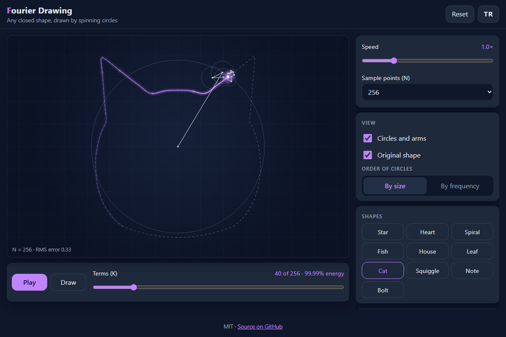

# Fourier Drawing - draw any closed shape with a chain of spinning circles

[](#tests)
[](LICENSE)

**▶ Open the app: https://celaldrg.github.io/fourier-drawing/**



## Features

- Draw a closed shape with your finger or the mouse, pick one of 10 built-in shapes, or paste SVG path data (`M L H V C S Q T A Z`, absolute and relative).
- The path is resampled to N points equally spaced by arc length (N = 64 to 1,024, default 256) and turned into epicycles with the discrete Fourier transform (radix-2 FFT, with a direct DFT as reference).
- Watch the circles and arms rotate while the tip traces the shape with a glowing, fading trail; the original shape can be shown faintly behind it.
- Choose how many terms K to use and see the share of energy they keep plus the RMS error of the reconstruction.
- Order the circles by size or by frequency, change the speed, and see a bar chart of the amplitudes.
- Share a drawing through the URL hash, or export the traced path as an SVG file.
- English and Turkish interface, dark theme, works on phones and desktops, no dependencies.

## How to use

| Action | Keyboard | Touch / mouse |
| --- | --- | --- |
| Play / pause | `Space` | Tap the canvas or press **Play** |
| More / fewer terms | `→` `↑` / `←` `↓` (`Shift` = ×10) | Terms slider |
| Restart the trace | `R` | **Reset** |
| Draw a new shape | `D` (`Esc` cancels) | **Draw**, then draw on the canvas and lift |

On phones the settings sit in a collapsible **Controls** panel below the canvas.

## Run locally

Any static file server works, for example:

```sh
npx serve .
```

Then open the printed address. ES modules need `http://`; opening `index.html` through `file://` does not work.

## Tests

```sh
node --test
```

The suite (Node 22, no dependencies) covers:

- DFT and FFT agree within 1e-9 on 50 seeded random inputs, and both inverses reproduce the input.
- A circle gives exactly one non-zero term; a square (N = 1,024) only has frequencies with k mod 4 = 1, and |c_k|·k² stays constant within 1% for |k| ≤ 41.
- Arc-length resampling spaces points equally within 1e-6 of the path length.
- The SVG path parser on 26 path strings (relative commands, implicit repeats, arcs) and bad input.
- For 10 shapes the RMS error never increases as K grows and is below 1e-9 with all terms; the chain tip at t = j/N equals point j.
- App state, URL-hash sharing, SVG export, storage and the EN/TR string tables.

## Project structure

```
index.html          page markup
style.css           styles
src/
  fourier.js        DFT, FFT and inverses
  path.js           cleaning, arc-length resampling, normalising
  svgpath.js        SVG path data parser
  shapes.js         built-in shapes
  epicycles.js      terms, chain positions, energy and error
  game.js           app state and animation clock
  share.js          URL hash and SVG export
  shortcuts.js      keyboard shortcut rules
  rng.js            seeded random numbers
  storage.js        safe localStorage wrapper
  i18n.js           English and Turkish strings
  render.js         canvas drawing (UI)
  main.js           DOM wiring, input and loop (UI)
test/               node:test suites
```

## License

MIT - see [LICENSE](LICENSE).

## Türkçe

Kapalı her şekli dönen çemberler zinciriyle çizen bir tarayıcı uygulaması.

**▶ Uygulamayı aç: https://celaldrg.github.io/fourier-drawing/**

### Özellikler

- Parmağınla ya da fareyle kapalı bir şekil çiz, 10 hazır şekilden birini seç ya da SVG yol verisi yapıştır (`M L H V C S Q T A Z`, mutlak ve göreli).
- Yol, yay uzunluğuna göre eşit aralıklı N noktaya yeniden örneklenir (N = 64–1.024, varsayılan 256) ve ayrık Fourier dönüşümüyle episikllere çevrilir (radix-2 FFT; doğrudan DFT referans olarak).
- Çemberler ve kollar dönerken uç, şekli parlayan ve sönen bir izle çizer; asıl şekil arkada soluk gösterilebilir.
- Kaç terim (K) kullanılacağını seç; tutulan enerji payını ve yeniden çizimin RMS hatasını gör.
- Çemberleri boyuta ya da frekansa göre sırala, hızı değiştir, genliklerin çubuk grafiğini gör.
- Çizimi URL hash'i ile paylaş ya da çizilen yolu SVG dosyası olarak indir.
- İngilizce ve Türkçe arayüz, koyu tema, telefonda ve masaüstünde çalışır, bağımlılık yok.

### Nasıl kullanılır

| İşlem | Klavye | Dokunmatik / fare |
| --- | --- | --- |
| Oynat / duraklat | `Boşluk` | Tuvale dokun ya da **Oynat** |
| Daha çok / az terim | `→` `↑` / `←` `↓` (`Shift` = ×10) | Terim kaydırıcısı |
| Çizimi baştan başlat | `R` | **Sıfırla** |
| Yeni şekil çiz | `D` (`Esc` vazgeçer) | **Çiz**, sonra tuvale çiz ve bırak |

Telefonda ayarlar tuvalin altındaki açılır **Ayarlar** panelindedir.

### Yerelde çalıştırma

Herhangi bir statik dosya sunucusu yeterli, örneğin:

```sh
npx serve .
```

Sonra yazdırılan adresi aç. ES modülleri `http://` ister; `index.html` dosyasını `file://` ile açmak çalışmaz.

### Testler

```sh
node --test
```

Testler (Node 22, bağımlılıksız) şunları kapsar: DFT ve FFT'nin 50 tohumlu rastgele girdide 1e-9 içinde uyuşması ve ters dönüşümler; çemberde tek terim; karede (N = 1.024) yalnız k mod 4 = 1 frekansları ve |k| ≤ 41 için |c_k|·k² değerinin %1 içinde sabit kalması; yay uzunluğuna göre eşit örnekleme; SVG yol ayrıştırıcısı (26 yol); 10 şekilde K arttıkça RMS hatanın artmaması ve tüm terimlerle 1e-9 altına inmesi; uygulama durumu, paylaşım, SVG dışa aktarma, depolama ve EN/TR metinleri.

### Proje yapısı

```
index.html          sayfa yapısı
style.css           stiller
src/
  fourier.js        DFT, FFT ve tersleri
  path.js           temizleme, yay uzunluğuna göre örnekleme, normalleştirme
  svgpath.js        SVG yol verisi ayrıştırıcısı
  shapes.js         hazır şekiller
  epicycles.js      terimler, zincir konumları, enerji ve hata
  game.js           uygulama durumu ve animasyon saati
  share.js          URL hash'i ve SVG dışa aktarma
  shortcuts.js      klavye kısayolu kuralları
  rng.js            tohumlu rastgele sayılar
  storage.js        güvenli localStorage sarmalayıcısı
  i18n.js           İngilizce ve Türkçe metinler
  render.js         canvas çizimi (arayüz)
  main.js           DOM bağlantıları, girdi ve döngü (arayüz)
test/               node:test paketleri
```

### Lisans

MIT - bkz. [LICENSE](LICENSE).
